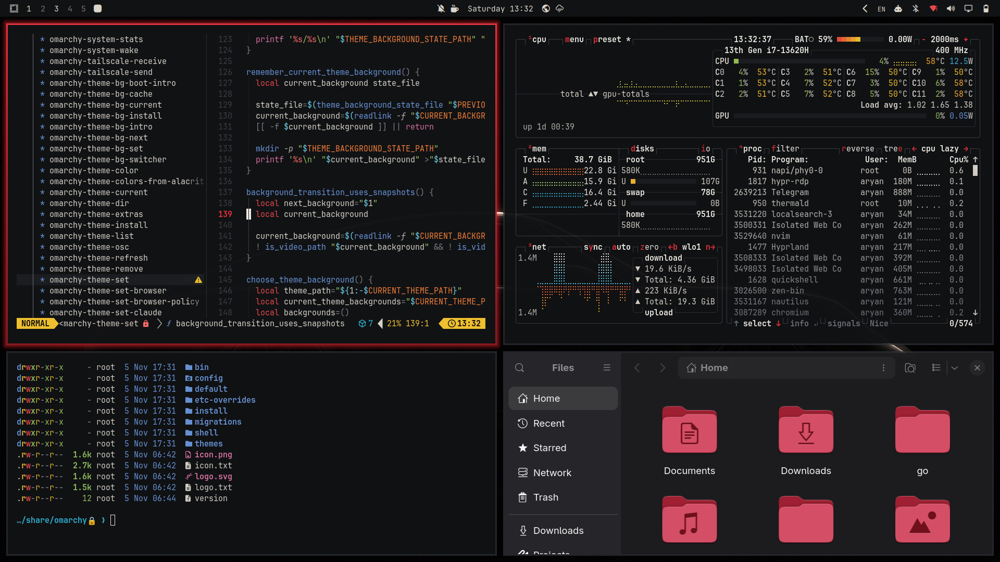
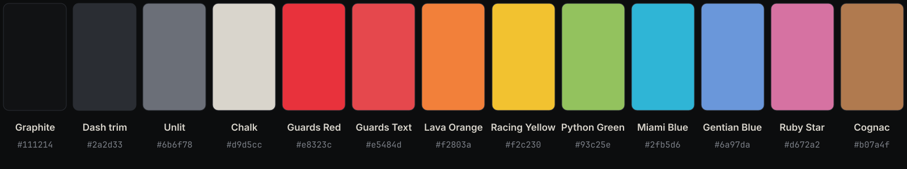
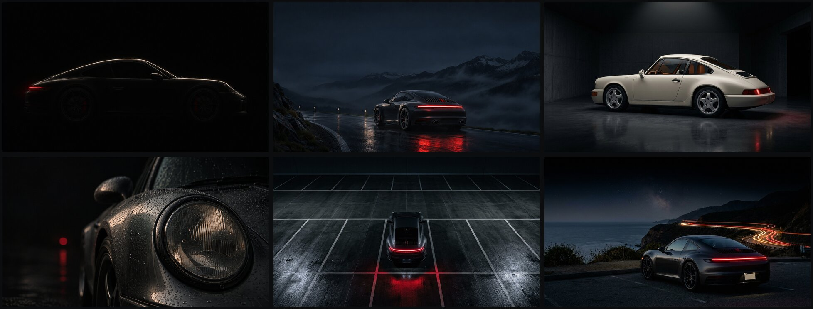

# Carrera

A dark [Omarchy](https://omarchy.org) theme inspired by the Porsche 911 on a night drive:
a graphite dashboard, chalk-white dial numerals, and Guards Red for the rev needle and the
full-width tail-light bar. Built for long coding sessions: calm contrast, colour that carries
meaning, and nothing bold that doesn't need to be.



## Install

```bash
omarchy theme install https://github.com/AryanHamedani/omarchy-carrera-theme
```

Or open the menu: **Style → Theme → Install**, and paste the URL.

## Palette



Every colour is named after a 911 paint or cabin detail. All text colours reach at least
4.5:1 contrast on the background (comments sit lower on purpose, at 3.7:1).

| Role | Colour | Hex |
|---|---|---|
| Background | Graphite dashboard | `#111214` |
| Text | Chalk | `#d9d5cc` |
| Accent, focus, cursor | Guards Red | `#e8323c` |
| Selection | Dash trim | `#2a2d33` |
| Comments | Unlit gauge markings | `#6b6f78` |
| red / orange / yellow | Guards Red, Lava Orange, Racing Yellow | `#e5484d` `#f2803a` `#f2c230` |
| green / cyan / blue | Python Green, Miami Blue, Gentian Blue | `#93c25e` `#2fb5d6` `#6a97da` |
| magenta / brown | Ruby Star, Cognac leather | `#d672a2` `#b07a4f` |

## Wallpapers



Six night scenes, all keyed on the red tail light. Cycle them with `omarchy theme bg next`.
Four have an intro that plays once when the theme or wallpaper is set, then settles on the
still (turn intros off with `omarchy theme bg intro disable`):

1. Flyline studio: the rim light sweeps along the roofline, tail light first
2. Alpine blue hour: a slow push in out of the dark
3. Air-cooled garage: the overhead tube flickers on
4. Headlight in the rain: a focus pull from soft to sharp
5. Parking deck
6. Coastal light trails

## What's themed

From `colors.toml`, through Omarchy's own templates: terminals (Alacritty, Foot, Ghostty,
Kitty), Neovim, VS Code, Helix, the Omarchy shell and bar, the lock screen, Chromium, tmux,
GNOME apps and more. On top of that, Carrera ships:

- **btop**: graphs that sweep like a tachometer, Python Green → Racing Yellow → Guards Red.
- **Window borders**: a tail-light gradient on the focused window.
- **Icons**: Yaru red.
- **Boot unlock screen**: the Omarchy wordmark in Guards Red, via **Style → Unlock** in the
  Omarchy menu.

### Extras for your own copy

Two files only apply when the theme is one you keep yourself, because Omarchy, by design,
doesn't run Lua from themes installed with `omarchy theme install`:

- `neovim.lua`: a developer-tuned syntax map. Keywords in Guards Red, functions in Gentian
  Blue, types in Racing Yellow, strings in Python Green, numbers and constants in Lava Orange,
  decorators in Cognac, builtins like `self` in Ruby Star; regular weight throughout, with a
  red-tinted selection and undercurled diagnostics.
- `hyprland.lua`: a faint red glow around the focused window, like brake lights on wet tarmac.

To opt in, read both files, then make the installed copy your own and re-apply it:

```bash
rm -rf ~/.config/omarchy/themes/carrera/.git
omarchy theme set carrera
```

That copy no longer updates with `omarchy theme install`; run the install again to go back.

## Credits

The wallpapers were generated for this theme with OpenAI's image model (through Codex) and
Google's image model (through Antigravity) from a single art-direction brief, then graded and
upscaled to 2560×1440.

Not affiliated with or endorsed by Porsche AG. Porsche, 911 and Carrera are trademarks of
Porsche AG.

## License

[MIT](LICENSE)
